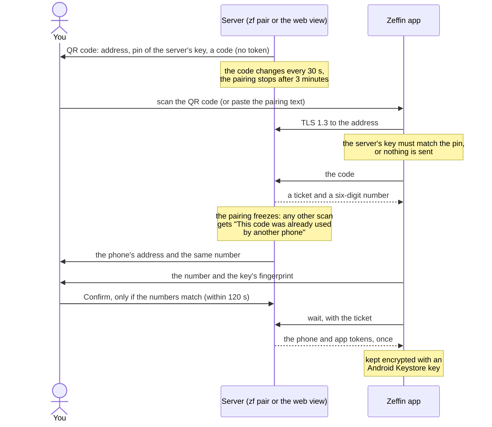

# Pair the app

The steps say where each one runs: **on the phone** or **on the server**.

## 1. Install the app (on the phone)

1. In the phone's browser, open the repository's *Releases* page (`https://github.com/samartined/zeffin/releases`) and download `zeffin-vX.Y.Z.apk`.
2. Open it. Android asks you to allow installing apps from that source; accept. Play Protect may warn that the app is unknown: that is normal for an app that does not come from Google Play.

Later versions signed with the same key install on top and keep the settings and the pairing. To check the APK against its release notes first, see [android-app.md](../android-app.md#check-the-apk-optional).

The app follows the phone's language (English or Spanish). You can change it in Settings, Language · Idioma.

## 2. Connect Tailscale (on the phone)

1. Install Tailscale and sign in to the same tailnet as the server.
2. In Android: Settings, Network, VPN, Tailscale: turn on **Always-on VPN** and **Block connections without VPN**. The tunnel then comes up by itself, and no other app sends anything outside it.
3. Turn off battery optimization for Tailscale.

The app sends nothing to the server outside Tailscale's tunnel: with Tailscale off it says "Tailscale is not connected on this phone" and waits ([Security](security.md#the-private-network)).

## 3. Pair the app with the server

`./install.sh` ends by showing the pairing QR code. Otherwise, or later, show it **on the server**:

```bash
zf pair
```

Or, from a browser on your tailnet: the web view, **Pair the app**, and type the view token again (`zf token view`).

Then, **on the phone**: Settings, Server, **Pair with QR code**, and point the camera at it. Without a second screen, copy the pairing text from the web view or from `zf pair` (in an SSH app) and use **Paste the pairing text**.



1. **The QR code holds no token:** the server's address, the pin of its key, and a code that changes every 30 seconds. The pairing stops after 3 minutes.
2. **The app checks the server's key against the pin** before it sends anything, and shows the key's fingerprint, the same one `zf status` prints.
3. **The phone and the server show the same six-digit number.** Confirm on the server only if it is the one on your phone. **If your phone shows no number, refuse.** The tokens leave only after you confirm.

**The fingerprint proves the server; the number proves the request.**

- **The QR code is as trustworthy as the screen that shows it:** `zf pair` in the server's own terminal, local or over SSH, is the most reliable.
- **Keep the QR code and the text to yourself:** no photo, no screenshot, no sharing. Cancel when unused (Ctrl+C in `zf pair`). The text is as private as the QR code, and the keyboard app can read the clipboard. That is why the code works once, lives about 35 seconds, and needs your confirmation.
- **Once a phone scans, the code is spent:** another scan gets "This code was already used by another phone", so a photographed QR code is useless from then on.
- **"This code was already used by another phone"** on your phone means another phone got there first. Refuse that request on the server: nothing was sent. If you already confirmed it, run `zf rotate-tokens`, then pair again where nobody can see the screen.
- **The web view's pairing belongs to the tab that opened it,** after you typed the view token again. If the web view says the pairing was not confirmed on it, and you did not confirm it with `zf pair`, run `zf rotate-tokens` and pair again.
- **Check the phone connections in the web view:** "App paired with a code" for each pairing, and every request that got nothing. An unknown pairing is an alarm.
- **Already paired with another server?** The app asks first; "Keep the current pairing" leaves it as it was.

The full contract is in [protocol/pairing/](../protocol/pairing/README.md).

## 4. Connect the Flipper (on the phone)

1. Pair the Flipper in Android's Bluetooth settings, if it is not paired yet.
2. In the app: Settings, Relay, **Device**, and choose your Flipper.
3. Turn on the relay with its switch (**Relay on**) and accept what Android asks for: nearby devices, notifications, and turning off battery optimization when the app suggests it.
4. **Start automatically** starts the relay whenever the app opens.

Home now shows the Flipper's screen live, **Pause agent**, **Resume** and **Remote**, and what the agent does.

**While the relay is on, do not open another app that connects to the Flipper over Bluetooth:** it would share the link, and the two sessions get mixed. The relay cannot detect this, because Android does not say which app holds the link. The web view stays available as a fallback.

## What the app shows

| Where | What |
|---|---|
| **Home** (the first tab, labelled with the connection's state) | The Flipper's screen, Pause agent, Resume, Remote, a permission the agent waits for, and every action of the agent |
| **Conversations** | Your conversations with the agent: search, filter and sort, favorites, pinned ones, selecting several, and a new conversation ([Use the agent](use-the-agent.md#the-conversations)) |
| **Settings** | Connections (Relay, Server, Agents), Agent (where new conversations start, permissions, notifications), App (Language · Idioma), Tools (Diagnostics, About) |

Zeffin's face, beside the state in Home and in a conversation, shows it at a glance: working, writing, asking, paused, offline. It never replaces a word, and it stays still with Android's "Remove animations".

The notifications the app can show, and their Android channels, are in [android-app.md](../android-app.md#notification-channels).

## Next

[Use the agent](use-the-agent.md).
