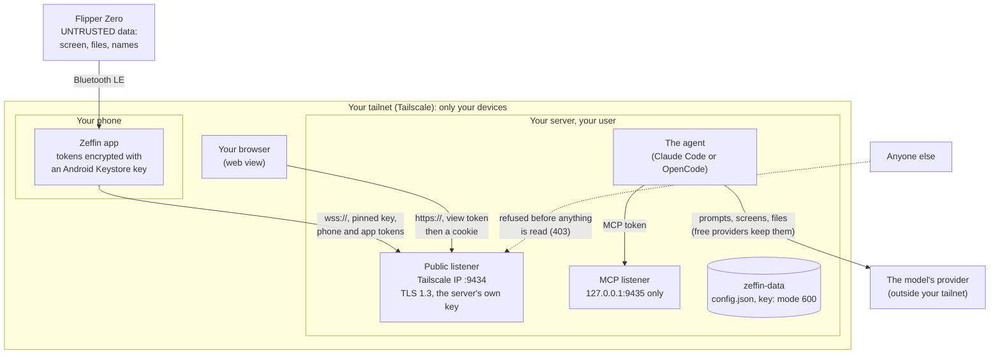

# Security

What Zeffin trusts, what protects each part, and what it does not protect. The full model, with every finding, is in [security.md](../security.md).

## What Zeffin does not stop

**Nothing technically stops the agent from transmitting.** While the agent is active, it can press any key, start any app and send any RPC request, and so it can make the Flipper transmit: Sub-GHz, infrared, NFC or RFID emulation, BadUSB.

- The agent folder's `CLAUDE.md` and `AGENTS.md` ask the agent not to transmit unless your request asks for it. That is an instruction to a model, not a guard.
- The Flipper tools never ask for permission, in any permission mode, also when OpenCode notices the agent repeating the same one (its `doom_loop` question, which Zeffin answers itself only for the Flipper tools).
- **Pause is the read-only mode:** while paused, every tool that changes the Flipper's state is refused, and only reading works ([Pause and Stop](pause-and-stop.md)). Pause when you are not watching.
- What you transmit, and where, is your responsibility: follow the laws where you are.

## The trust boundaries

- **Trusted:** your server and your user on it; your tailnet; the server's own key, pinned by the app when you pair.
- **Not trusted:** whatever comes from the Flipper (its screen, file names and contents, device information) and the agent's own output. It is cut and cleaned where it enters, handed to the agent as data, and shown to you without control or invisible characters.
- **The model's provider is outside your network:** what the agent sends (your messages, attachments, and what it reads from the Flipper) leaves the server for Anthropic (Claude Code) or OpenCode's provider, under their terms ([below](#the-agents-account-and-your-data)).
- **Other users on the server are not trusted:** `config.json` and the server's key are readable only by you, and `zf` sends a token to a local listener only after checking it belongs to your user.

## The private network

- **The server listens only on its Tailscale address** (and loopback). `zf init` and `zf set-host` refuse any other address.
- **It serves only tailnet or loopback peers:** any other gets 403 before anything else is read, and a `peer_refused` line in the metrics.
- **The app sends nothing outside Tailscale's tunnel:** each connection is bound to the VPN network whose route covers the server's Tailscale address, or refused before any byte. A VPN that takes all the traffic does not count, and no proxy is ever used.
- **The MCP listener is on `127.0.0.1` only,** so the agent's tools are reachable only from the server itself.
- **Your tailnet policy** should let only your devices reach port 9434 ([Install the server](install-the-server.md#let-only-your-devices-in-tailscale-policy)).

## The pinned key

- **The server has its own key** (P-256), made by `zf init` in the data folder, never in the repository, a log or a chat.
- **Port 9434 speaks only TLS 1.3 with it.** The pairing QR code carries the key's pin, and the app checks it in the TLS handshake before it sends a token, a code or a message. A server with another key is a hard error: "The server's key changed", and nothing is sent.
- **The fingerprint** (`zf status`, `zf key`, the app's Server settings) is the same string everywhere: compare it when you pair.
- **The web view in a browser is not pinned:** the browser warns once about the self-signed certificate; compare it with the fingerprint.
- **`zf key new`** replaces the key and, by default, the phone and app tokens: pair again afterwards.

## Tokens

- **Four separate 256-bit tokens:** phone (the relay), MCP (the agent), view (the web view) and app (the app's chat and status). They live in `config.json`, mode 600; the server refuses to start if other users can read it.
- **Never printed, logged or put on a command line** by Zeffin. `zf token phone|mcp|view|app` prints one when you ask.
- **The web view** exchanges the view token once for an `HttpOnly`, `SameSite=Strict` cookie that holds a hash of it, never the token; its actions need a custom header.
- **`zf rotate-tokens`** replaces them ([Updating](updating.md#rotate-the-tokens)).
- **Known limit:** with the entry `zf mcp-config` writes, every interactive `claude` you start sends the MCP token to port 9435, also while Zeffin is down. That is how Claude Code connects to MCP servers.

## The agent's account and your data

- **Claude Code** with your own login, never `--bare` and never a token on its command line. Anthropic's terms for your account apply to what it sends (code.claude.com/docs/en/data-usage).
- **OpenCode** on the providers you signed in, with an allow-listed environment (no provider's key, no token), sharing and auto-update off, and the model you chose ([Use the agent](use-the-agent.md#what-each-agent-uses)).
- **Free providers keep what they receive to improve their models.** With OpenCode, that includes what the agent reads from the Flipper: its screen, file names and contents, NFC or RFID dumps. Use Claude Code, or keep such data out of the conversation, when that matters ([Use the agent](use-the-agent.md#what-free-providers-keep)).
- **The MCP token is never on a command line:** a Claude Code turn reads it from an environment variable (`ZEFFIN_MCP_TOKEN`) named in its MCP configuration; OpenCode gets it through its own pipe, so its shell tool cannot read it, and it was not found in OpenCode's session files or logs after a turn (checked with 1.19.5).
- **A provider's key** (NVIDIA's, or another's) lives in OpenCode's own credentials file, which you type it into with `opencode auth login`. Zeffin never reads it.

## What is logged

- `state/audit.jsonl`: every tool call, with its arguments cut, its result and the frames before and after; every Pause, Resume and Stop with who made it.
- `state/metrics.jsonl`: connections, frames, pings, refused peers and pairings that got nothing.
- Each is kept to its newest 8 MiB. Tokens, pairing codes and numbers never reach them. What else is kept, and for how long: [security.md](../security.md#what-the-server-keeps-on-disk).

## Reporting a vulnerability

See [SECURITY.md](../../SECURITY.md).
