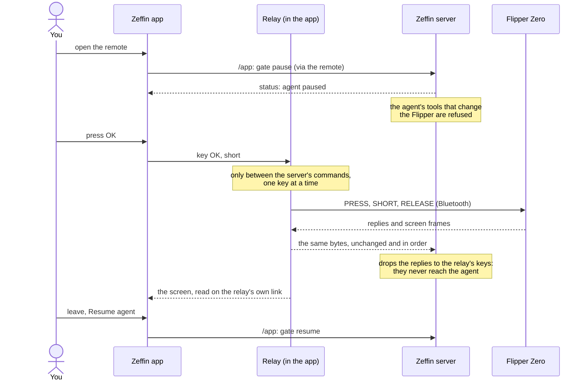

# The remote

The app's remote lets you drive the Flipper yourself from the phone: its screen, the arrows around **OK**, and **Back**. Open it with **Remote** on Home (also "Use the remote" while Home is offline).

- **Tap** a key for a short press; **hold** it for a long press.
- The screen is the one the relay reads on its own Bluetooth link, so it follows your keys without waiting for the server.
- The relay must be on. If it is off, the remote says so and offers **Start the relay**.

## The agent is paused while you drive

You and the agent never press keys at the same time:

- **With the server connected,** opening the remote pauses the agent first ("Paused by the remote. The agent cannot touch the Flipper."). The keys work once the server says it is paused. An agent you had already paused is left as it is.
- **If the agent is in the middle of a file transfer,** the remote waits for it: "Pausing: finishing the agent's transfer. The keys come back when it ends."
- **If the agent is resumed elsewhere** (the web view, another phone) while the remote is open, the keys go off, and **Pause agent** is offered.
- **If the app is not connected to the server,** the keys stay off, with **Retry**: the remote cannot pause the agent from there.
- **When you leave,** if the remote paused the agent, the app asks: **Resume agent** or **Leave it paused**. The remote never resumes the agent by itself.

## Without the server

When the relay has no session with the server (the server is down, Tailscale is off, or the agent is stopped), the relay holds the Flipper for the remote alone, and does not connect to the server while the remote is open, so the agent cannot start in the middle of what you do.

## How it travels

- **The relay shares the Flipper's one RPC session with the server,** told apart by message ids: the server's below one range, the relay's in another ([protocol/rpc/](../protocol/rpc/README.md)).
- **The relay never changes the server's bytes:** everything from the Flipper goes to the server first, as it came.
- **The relay writes a key only when the server has no command open,** and only after reading its bytes back as the three requests of a key press.

The design is in [architecture.md](../architecture.md#the-relays-own-use-of-the-link).
