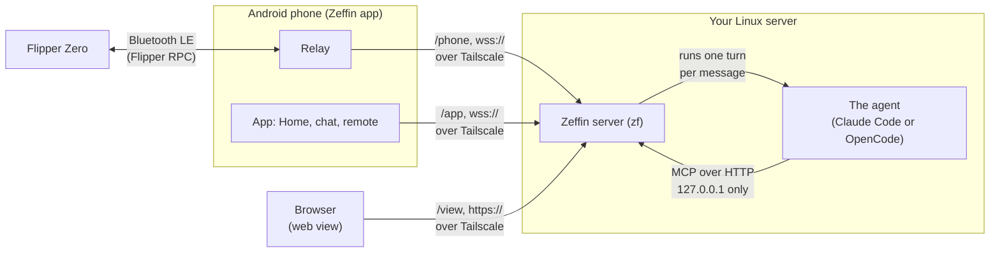

# What Zeffin is and what it needs

Zeffin lets an AI agent drive a Flipper Zero wirelessly, from any network, with an Android phone as the bridge. You talk to the agent from the Zeffin app on the phone (or from a terminal on the server), watch the Flipper's screen live, and can pause the agent at any moment.

- **The agent sees the screen and presses buttons** like a person with a remote control, so it can reach any app or menu of the Flipper. It also has file tools, app tools and a generic request for what is not on screen ([The Flipper tools](flipper-tools.md)).
- **The agent runs on your own server:** Claude Code or OpenCode, chosen per conversation, with the login or providers you set up ([Use the agent](use-the-agent.md#what-each-agent-uses)).
- **The phone is the bridge:** it holds the Flipper's Bluetooth link and forwards it to the server over your private network.
- **You stay in control:** a live view, an audit log of every call, Pause (read-only) and Stop ([Pause and Stop](pause-and-stop.md)).

## How the pieces fit

- **The relay** (inside the app) is a byte pipe: it forwards the Flipper's RPC over a WebSocket that the phone itself opens to your server. The phone always dials out; the server never connects to the phone.
- **The Zeffin server** keeps the session with the phone and the screen stream open, offers the `flipper_*` tools to the agent over MCP on loopback only, serves the app and the web view on your Tailscale address, and logs everything the agent does.
- **The agent** runs on the server. For each message you send from the app, the server starts one turn of the conversation's agent in the agent folder (`claude -p`, or `opencode acp`), with the Flipper's MCP server.
- **The web view** (`https://100.98.12.7:9434/view` in the examples) is a backup: the live screen, Pause, Resume, Stop relay and pairing, from any browser on your tailnet.

The layers inside the server and the app are in [architecture.md](../architecture.md).

## What you need

| | What | Why |
|---|---|---|
| **Flipper Zero** | The official firmware, or a fork that keeps its RPC over Bluetooth | The device the agent drives |
| **Android phone** | Android 14 or later | Runs the Zeffin app: the relay, the chat and the remote |
| **A Linux server that stays on** | Python 3.11 or later, systemd (a user service), `git` | Runs the Zeffin server and the agent. A small always-on machine is enough |
| **Tailscale** | On the server and on the phone, in the same tailnet | The private network every connection goes through. Zeffin refuses any other network |
| **An agent** | Claude Code, signed in with a Claude subscription or another login; or OpenCode (with Node.js for `npm`): free with OpenCode Zen's free models (no account) or NVIDIA NIM's free tier, or on any provider you sign in | The agent that drives the Flipper. A model that bills per use says **Paid** in the app |

- The server does not need to be reachable from the internet, and must not be: Zeffin only listens on its Tailscale address and on loopback.
- The phone needs mobile data or Wi-Fi with Tailscale on, and Bluetooth on, near the Flipper.
- Claude Code's login is yours: with a subscription, keep paid extra usage off in your Claude account if you want a hard limit. Free providers keep what they receive to improve their models ([Use the agent](use-the-agent.md#what-each-agent-uses)).

## Next

1. [Install the server](install-the-server.md).
2. [Pair the app](pair-the-app.md).
3. [Use the agent](use-the-agent.md).
